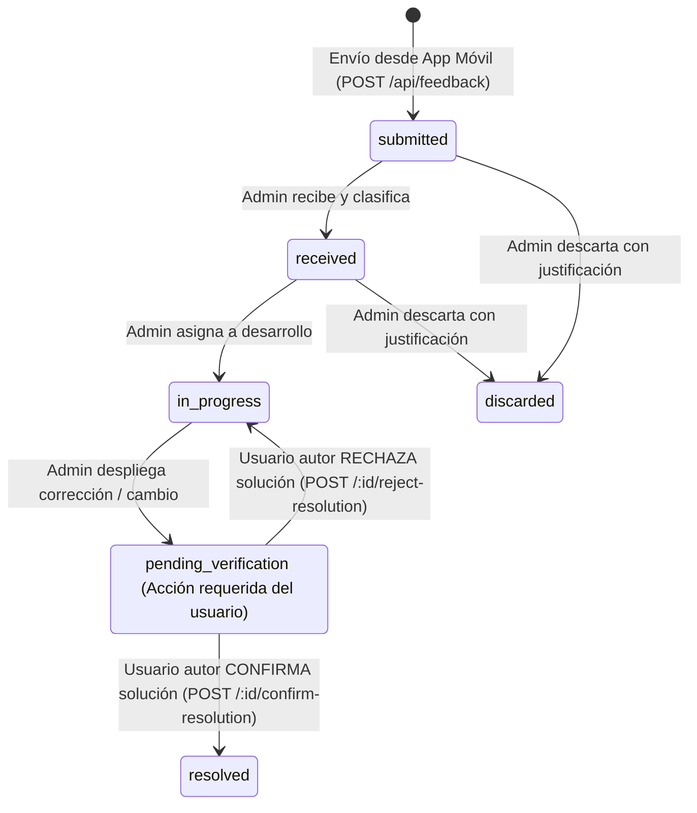

# Guía de Desarrollo: Panel de Administración de Feedback (Back-Office)

> **Documento:** Guía de Arquitectura, Diseño UI/UX y Buenas Prácticas para el Panel de Administración  
> **Plataforma:** YouConnext Web Admin (React / Next.js / TypeScript)  
> **Backend:** carpooling-user (Node.js / Express / Prisma / MySQL)  
> **Fecha:** Noviembre 2026  

---

## 1. Introducción y Objetivos

El **Módulo de Feedback en el Panel de Administración** es la herramienta operativa que permite al equipo de producto, ingeniería y atención al usuario supervisar, clasificar (triage) y dar resolución a las sugerencias e incidencias reportadas por conductores, pasajeros y organizaciones desde **YouConnextApp**.

### Objetivos Clave de la Herramienta:
1. **Visibilidad Centralizada**: Monitorizar en tiempo real el pulso de la comunidad y la salud técnica de la aplicación.
2. **Eficiencia en el Triage**: Reducir el tiempo medio de respuesta (MTTR) asignando estados, prioridades y notas de seguimiento interno.
3. **Gobierno de Categorías en Caliente ("Zero-Deploy")**: Administrar qué categorías se ofrecen a los usuarios sin necesidad de publicar nuevas versiones a las tiendas móviles.
4. **Cierre de Ciclo con el Usuario**: Notificar automáticamente al autor cuando su sugerencia haya sido implementada o su fallo resuelto.

---

## 2. Arquitectura de Frontend Web Recomendada

Para mantener el estándar de excelencia de YouConnext, la aplicación de administración web debe construirse con una arquitectura moderna, tipada y desacoplada.

### 2.1. Stack Tecnológico Estándar
- **Framework:** **Next.js (App Router)** o **React 19 con Vite / TypeScript**.
- **Estilos & Diseño:** **Tailwind CSS** con la paleta oficial de YouConnext (Verde `#0B7A3B`, Fondo `#EEF5F0`, Ámbar `#F2A33C`).
- **Librería de Componentes:** Primitivas accesibles como **Radix UI** o **shadcn/ui**.
- **Gestor de Estado del Servidor:** **TanStack Query (React Query v5)** para caché inteligente, paginación suave y revalidaciones optimistas.
- **Tablas de Datos:** **TanStack Table v8** (renderizado virtualizado, ordenación y filtrado server-side).
- **Iconografía:** **Lucide React**.

### 2.2. Estructura de Directorios (Feature-Driven Architecture)

```
src/
└── features/
    └── feedback/
        ├── components/
        │   ├── FeedbackDashboard.tsx        # KPIs y tarjetas de métricas
        │   ├── FeedbackTable.tsx            # Data Table principal interactiva
        │   ├── FeedbackFilters.tsx          # Barra de filtros combinados
        │   ├── FeedbackDetailDrawer.tsx     # Panel lateral de triage y detalle
        │   ├── StatusTransitionModal.tsx    # Modal para cambio de estado y motivo
        │   ├── NotesTimeline.tsx            # Feed cronológico de notas internas
        │   └── CategoryManagerModal.tsx     # Gestor de categorías dinámicas
        ├── hooks/
        │   ├── useFeedbackList.ts           # Consulta paginada con TanStack Query
        │   ├── useFeedbackDetail.ts         # Detalle e historial por ID
        │   ├── useFeedbackMetrics.ts        # KPIs consolidados
        │   ├── useUpdateFeedbackStatus.ts   # Mutación de estado con revalidación optimista
        │   ├── useAddFeedbackNote.ts        # Mutación para añadir nota interna
        │   └── useFeedbackCategories.ts     # CRUD de categorías
        ├── services/
        │   └── feedbackAdminApi.ts          # Cliente Axios / Fetch hacia /api/admin/feedback
        └── types/
            └── feedback.types.ts            # Tipos e interfaces TypeScript exhaustivas
```

---

## 3. Modelo de Base de Datos Relacional (Prisma & MySQL)

El modelo de datos relacional garantiza integridad referencial, soporte multi-rol (usuarios particulares y empresas) y trazabilidad inmutable mediante logs de auditoría.

### 3.1. Esquema Prisma (`schema.prisma`)

```prisma
// Modelo Principal de Feedback
model Feedback {
  id              String             @id @default(uuid()) @db.VarChar(36)
  title           String?            @db.VarChar(150)
  category_id     String             @db.VarChar(50)
  message         String             @db.VarChar(1024)
  status          FeedbackStatus     @default(PENDING)
  author_type     FeedbackAuthorType @default(USER)
  
  // Relaciones opcionales según el tipo de autor
  user_id         String?            @db.VarChar(36)
  enterprise_id   String?            @db.VarChar(36)
  
  // Metadatos de telemetría capturados del cliente móvil
  device_platform String?            @db.VarChar(20) // "iOS", "Android", "Web"
  app_version     String?            @db.VarChar(20) // "1.0.0"
  os_version      String?            @db.VarChar(20) // "14.2"
  
  created_at      DateTime           @default(now())
  updated_at      DateTime           @updatedAt

  // Relaciones
  category        FeedbackCategory   @relation(fields: [category_id], references: [id])
  status_logs     FeedbackStatusLog[]
  notes           FeedbackNote[]

  @@index([status, created_at])
  @@index([category_id, created_at])
  @@index([user_id])
  @@index([enterprise_id])
  @@map("feedbacks")
}

// Catálogo Dinámico de Categorías
model FeedbackCategory {
  id          String     @id @db.VarChar(50) // "bug", "improvement", "usability", etc.
  label       String     @db.VarChar(100)
  description String     @db.VarChar(255)
  icon        String     @db.VarChar(50)     // Nombre Lucide o emoji
  color       String     @default("#0B7A3B") @db.VarChar(20)
  is_active   Boolean    @default(true)
  sort_order  Int        @default(0)
  created_at  DateTime   @default(now())
  updated_at  DateTime   @updatedAt

  feedbacks   Feedback[]

  @@map("feedback_categories")
}

// Historial Inmutable de Cambios de Estado (Audit Log)
model FeedbackStatusLog {
  id              String         @id @default(uuid()) @db.VarChar(36)
  feedback_id     String         @db.VarChar(36)
  previous_status FeedbackStatus
  new_status      FeedbackStatus
  reason          String         @db.VarChar(500)
  changed_by_id   String         @db.VarChar(36) // ID del admin que realizó el cambio
  changed_by_name String         @db.VarChar(100)
  user_notified   Boolean        @default(false)
  created_at      DateTime       @default(now())

  feedback        Feedback       @relation(fields: [feedback_id], references: [id], onDelete: Cascade)

  @@index([feedback_id, created_at])
  @@map("feedback_status_logs")
}

// Notas Internas Privadas para el Equipo
model FeedbackNote {
  id             String    @id @default(uuid()) @db.VarChar(36)
  feedback_id    String    @db.VarChar(36)
  content        String    @db.Text
  author_id      String    @db.VarChar(36)
  author_name    String    @db.VarChar(100)
  created_at     DateTime  @default(now())

  feedback       Feedback  @relation(fields: [feedback_id], references: [id], onDelete: Cascade)

  @@index([feedback_id])
  @@map("feedback_notes")
}

enum FeedbackStatus {
  submitted             // Enviado inicial por el usuario o empresa
  received              // Recibido y clasificado por el Admin
  in_progress           // En desarrollo técnico activo
  pending_verification  // Cambio desplegado, pendiente de prueba por el usuario
  resolved              // Resuelto (confirmado EXCLUSIVAMENTE por el usuario autor)
  discarded             // Descartado por el Admin con justificación
}

enum FeedbackAuthorType {
  USER
  ENTERPRISE
}
```

---

## 4. Flujo de Trabajo y Ciclo de Vida del Feedback (Triage)



### Reglas de Negocio en Transiciones de Estado:
1. **Gobernanza Asimétrica de Resolución:** El administrador tiene **bloqueada** la transición directa a `resolved` (HTTP 400). Solo el usuario autor puede confirmar la resolución definitiva tras probar el cambio desplegado en `pending_verification`.
2. **Rechazo por el Usuario:** Si el usuario prueba el cambio y sigue fallando, puede rechazarlo aportando una explicación (mínimo 5 caracteres), lo cual devuelve el ticket a `in_progress`.
3. **Motivo Obligatorio:** Todo cambio de estado realizado por el administrador debe registrar un campo `reason` en `FeedbackStatusLog`.


---

## 5. Diseño UI/UX del Panel de Administración

### 5.1. Dashboard de Métricas y KPIs
En la parte superior de la vista de Feedback, se sitúan 4 tarjetas analíticas principales:

| Métrica | Cálculo | Indicador Visual |
| :--- | :--- | :--- |
| **Total Recibidos** | Conteo total del periodo seleccionado. | Icono `Inbox` neutral. |
| **Pendientes de Triage** | Feedbacks en estado `PENDING`. | Badge ámbar de atención. |
| **En Curso / Desarrollo** | `IN_REVIEW` + `IN_PROGRESS`. | Badge azul de actividad. |
| **Tasa de Resolución** | `(RESOLVED / Total) * 100`. | Porcentaje en verde YouConnext. |

### 5.2. Barra de Filtros Combinados
- **Buscador global:** Búsqueda en vivo (debounced a 300 ms) por texto en título, contenido o email del autor.
- **Filtro de Estado:** Selector de chips (`Todos`, `Pendiente`, `En Revisión`, `En Progreso`, `Resuelto`, `Descartado`).
- **Filtro de Categoría:** Desplegable multi-categoría sincronizado con `FeedbackCategory`.
- **Selector de Rango Temporal:** Filtro rápido (`Hoy`, `Últimos 7 días`, `Últimos 30 días`, `Rango personalizado`).
- **Botón de Exportación:** Descarga instantánea en formato CSV o Excel para informes de producto.

### 5.3. Drawer de Detalle y Triage (Panel Lateral Deslizante)
Al hacer clic en cualquier fila de la tabla, se abre un panel lateral deslizante (Drawer) sin perder la posición ni el scroll en la tabla:
- **Cabecera del Drawer:** ID de feedback, badge de estado actual, botón para cambiar estado y selector de acciones rápidas.
- **Tarjeta del Autor:** Avatar, nombre completo, correo, teléfono y badge identificador (`Particular` o `Empresa Corporativa`).
- **Contenido del Feedback:** Título en negrita, categoría asignada con su icono representativo y texto completo del mensaje.
- **Detalles del Entorno:** Dispositivo, versión de la app y sistema operativo.
- **Línea de Tiempo de Auditoría (Audit Log):** Lista cronológica de cambios de estado y notas internas registradas por los administradores.
- **Caja de Entrada de Notas:** Área de texto para añadir comentarios de trabajo privados entre el equipo.

---

## 6. Buenas Prácticas de Ingeniería, Seguridad y Rendimiento

### 6.1. Prevención Estricta contra Stored XSS
El contenido del feedback es texto generado por usuarios externos. Para evitar vulnerabilidades graves en el panel de administración:
- **Nunca utilizar `dangerouslySetInnerHTML`** para pintar el título o mensaje.
- Renderizar los textos como nodos hijos nativos de React:
  ```tsx
  {/* Correcto y seguro contra XSS */}
  <p className="text-gray-800 text-sm whitespace-pre-wrap">{feedback.message}</p>
  ```
- Si se requiere resaltar palabras clave de búsqueda con HTML enriquecido, sanear previamente con la librería **DOMPurify**:
  ```tsx
  import DOMPurify from "dompurify";
  const sanitized = DOMPurify.sanitize(highlightedHtml);
  ```

### 6.2. Revalidación Optimista con TanStack Query
Al cambiar el estado o añadir una nota, actualizar la caché en memoria de TanStack Query inmediatamente para una experiencia ultra-rápida (0 ms de latencia percibida):

```typescript
export function useUpdateFeedbackStatus() {
  const queryClient = useQueryClient();

  return useMutation({
    mutationFn: ({ id, status, reason }: UpdateStatusParams) =>
      feedbackAdminApi.updateStatus(id, { status, reason }),
    onMutate: async ({ id, status }) => {
      // 1. Cancelar peticiones salientes
      await queryClient.cancelQueries({ queryKey: ["feedback", id] });
      // 2. Guardar snapshot previo para rollback si falla
      const previous = queryClient.getQueryData(["feedback", id]);
      // 3. Actualizar optimísticamente
      queryClient.setQueryData(["feedback", id], (old: any) => ({
        ...old,
        status,
      }));
      return { previous };
    },
    onError: (err, variables, context) => {
      if (context?.previous) {
        queryClient.setQueryData(["feedback", variables.id], context.previous);
      }
    },
    onSettled: (data, error, variables) => {
      queryClient.invalidateQueries({ queryKey: ["feedback", variables.id] });
      queryClient.invalidateQueries({ queryKey: ["feedback-list"] });
      queryClient.invalidateQueries({ queryKey: ["feedback-metrics"] });
    },
  });
}
```

### 6.3. Paginación y Consultas de Alto Rendimiento
- **Paginación en Servidor:** No cargar nunca todos los registros de golpe en el navegador. La API debe procesar `page` y `limit` mediante `skip` y `take` de Prisma.
- **Debounce en Búsqueda:** Aplicar un retardo de al menos `300 ms` al escribir en el campo de búsqueda antes de emitir la petición HTTP.
- **Índices en Base de Datos:** Los índices compuestos `[status, created_at]` y `[category_id, created_at]` garantizan respuestas en menos de 50 ms incluso con decenas de miles de registros.

---

## 7. Checklist de Implementación para el Equipo Web Admin

| Tarea | Descripción | Estado |
| :--- | :--- | :---: |
| **Esquema de BD** | Crear modelos `Feedback`, `FeedbackCategory`, `FeedbackStatusLog`, `FeedbackNote` en Prisma. | [ ] |
| **API Backend** | Implementar rutas en `/api/admin/feedback` protegidas con middleware `onlyAdmin`. | [ ] |
| **Data Table** | Configurar TanStack Table v8 con ordenación por fecha y selector de páginas. | [ ] |
| **Filtros** | Implementar filtros sincronizados en la URL (`/admin/feedback?status=pending&category=bug`). | [ ] |
| **Drawer de Detalle** | Montar el panel lateral deslizante con historial de auditoría y notas internas. | [ ] |
| **Seguridad XSS** | Verificar que no existan renderizados inseguros de entradas de usuario. | [ ] |
| **Gestor de Categorías** | Crear la pantalla/modal de gestión de categorías para soportar *Zero-Deploy Updates*. | [ ] |
