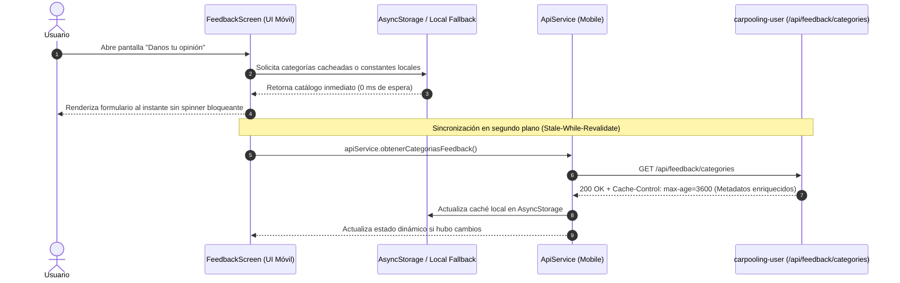

# Guía de Integración Móvil: Sistema y Sección de Feedback en YouConnext

Esta guía técnica y práctica documenta la integración integral del nuevo módulo de **Feedback y Sugerencias** en la aplicación móvil de YouConnext (**YouConnextApp**, desarrollada con **React Native v0.85, Expo v56 y React Navigation v7**).

---

## 1. Arquitectura de Descubrimiento de Categorías

### ¿Cómo sabe el Frontend qué categorías existen y cuál es la mejor práctica?

En aplicaciones móviles distribuidas, depender de categorías *hardcodeadas* exclusivamente en el código cliente es un antipatrón conocido como **Fragile Client Coupling** (acoplamiento frágil). Si el equipo añade o renombra una categoría en el servidor, los usuarios móviles no verán los cambios hasta que descarguen una nueva versión desde **Google Play** o **Apple App Store**, proceso que puede demorar días por las fases de revisión y despliegue escalonado.

Para resolver este desafío, la arquitectura implementada sigue el estándar de la industria (utilizado por plataformas como Uber, Stripe o Airbnb) mediante la combinación de **dos patrones complementarios**:



### Los Dos Pilares de la Solución:

1. **Backend-Driven Metadata (`GET /api/feedback/categories`) (Fuente Única de Verdad)**:
   - El backend es el dueño absoluto de qué categorías son válidas.
   - Devuelve un objeto enriquecido con identificador técnico (`id`), etiqueta visual legible (`label`), descripción corta orientativa (`description`), icono sugerido (`icon`) y los textos explicativos globales de la sección (`title`, `description`).
   - **Zero-Deploy Updates**: Si mañana se añade la categoría `accessibility` ("Accesibilidad"), aparecerá inmediatamente en todas las apps móviles sin compilar un nuevo APK ni forzar una actualización.
   - **Caché HTTP**: El endpoint emite la cabecera `Cache-Control: public, max-age=3600` (1 hora) para que la app y el sistema no repitan peticiones innecesarias.

2. **Offline Fallback & Stale-While-Revalidate (Resiliencia Móvil)**:
   - La app móvil incluye un catálogo local por defecto en `src/constants/feedback.js`.
   - Cuando el usuario entra en la sección de feedback, la pantalla se muestra **instantáneamente (0 ms)** con los datos locales o cacheados en `AsyncStorage`.
   - En segundo plano se consulta el backend. Si hay conectividad, la UI se actualiza con la versión más fresca; si el dispositivo está sin cobertura, el usuario puede seguir escribiendo su feedback sin pantallas bloqueadas ni spinners eternos.

---

## 2. Contrato de la API REST (`carpooling-user`)

### Endpoint 1: Obtener Metadatos y Categorías

- **Ruta**: `GET /api/feedback/categories`
- **Autenticación**: Pública (no requiere token; accesible para pintar el formulario).
- **Cabeceras de Respuesta**: `Cache-Control: public, max-age=3600`

#### Respuesta Exitosa (`200 OK`):
```json
{
  "status": "Success",
  "data": {
    "title": "Buzón de Sugerencias y Feedback",
    "description": "Tu opinión es fundamental para nosotros. Envíanos tus comentarios, reportes de fallos o propuestas de nuevas funciones para seguir mejorando YouConnext.",
    "maxTitleLength": 150,
    "maxMessageLength": 1024,
    "categories": [
      {
        "id": "bug",
        "label": "Reportar un fallo",
        "description": "Informa sobre errores técnicos, pantallas rotas o mal funcionamiento.",
        "icon": "bug"
      },
      {
        "id": "improvement",
        "label": "Propuesta de mejora",
        "description": "Sugiere nuevas características o ideas para la plataforma.",
        "icon": "lightbulb"
      },
      {
        "id": "usability",
        "label": "Experiencia de uso (Diseño)",
        "description": "Comenta sobre la navegación, facilidad de uso o diseño visual.",
        "icon": "sparkles"
      },
      {
        "id": "performance",
        "label": "Rendimiento y velocidad",
        "description": "Reporta tiempos de carga lentos o problemas de respuesta.",
        "icon": "gauge"
      },
      {
        "id": "service",
        "label": "Servicio de Carpooling",
        "description": "Feedback relacionado con reservas, cancelaciones o trayectos.",
        "icon": "car"
      },
      {
        "id": "organization",
        "label": "Gestión Corporativa",
        "description": "Específico para administradores y empleados de organizaciones.",
        "icon": "building"
      },
      {
        "id": "other",
        "label": "Otros comentarios",
        "description": "Cualquier otra inquietud o mensaje general.",
        "icon": "message-square"
      }
    ]
  }
}
```

---

### Endpoint 2: Enviar Feedback (Creación)

- **Ruta**: `POST /api/feedback`
- **Autenticación**: **Obligatoria** (`Authorization: Bearer <access_token>`).
- **Soporte de Autores**:
  - Usuarios particulares: se asocia automáticamente su `user_id`.
  - Organizaciones o empleados corporativos: se asocia automáticamente `enterprise_id` y `author_type: "enterprise"`.
- **Seguridad**:
  - **Límite de Longitud**: Título (3 a 150 caracteres), Mensaje (10 a 1024 caracteres).
  - **Sanitización Activa**: Se eliminan etiquetas HTML (`<script>`, `<iframe>`), eventos inline (`onerror=`) y caracteres nulos (`\0`).
  - **Rate Limiting**: Máximo **5 envíos cada 15 minutos** por usuario/organización/IP.

#### Payload de Envío (`Request Body`):
```json
{
  "title": "Error al confirmar reserva",
  "category": "bug",
  "message": "Cuando pulso el botón de reservar en el trayecto Madrid-Toledo la pantalla se queda en blanco."
}
```

#### Respuestas Posibles:

##### A. Creación Exitosa (`201 Created`):
```json
{
  "status": "Success",
  "message": "Feedback enviado correctamente. Gracias por ayudarnos a mejorar.",
  "data": {
    "id": "c1f7a28e-5b1e-48a3-9b0d-132a0d9e8b21",
    "title": "Error al confirmar reserva",
    "category": "bug",
    "message": "Cuando pulso el botón de reservar en el trayecto Madrid-Toledo la pantalla se queda en blanco.",
    "status": "pending",
    "author_type": "user",
    "created_at": "2026-11-16T12:00:00.000Z"
  }
}
```

##### B. Error de Validación (`400 Bad Request`):
```json
{
  "status": "Error",
  "code": "VALIDATION_ERROR",
  "message": "Los datos proporcionados no cumplen con el formato requerido.",
  "errors": [
    {
      "field": "message",
      "message": "El mensaje no puede superar los 1024 caracteres."
    }
  ]
}
```

##### C. Error de Autenticación (`401 Unauthorized`):
```json
{
  "status": "Error",
  "message": "Token inválido o expirado."
}
```

##### D. Límite de Peticiones Excedido (`429 Too Many Requests`):
```json
{
  "status": "Error",
  "code": "FEEDBACK_RATE_LIMIT",
  "message": "Has superado el límite de envíos de feedback. Por favor, espera 15 minutos antes de enviar un nuevo comentario."
}
```

---

### Endpoint 3: Listar Feedbacks Propios del Autor

- **Ruta**: `GET /api/feedback/mine`
- **Autenticación**: **Obligatoria** (`Authorization: Bearer <access_token>`).
- **Propósito**: Permite a la app móvil renderizar la pestaña **"Mis consultas"** con el historial de reportes del usuario, sus estados actuales y las notas de respuesta del equipo de YouConnext.

#### Respuesta Exitosa (`200 OK`):
```json
{
  "status": "Success",
  "data": {
    "feedbacks": [
      {
        "id": "c1f7a28e-5b1e-48a3-9b0d-132a0d9e8b21",
        "title": "Error al confirmar reserva",
        "category": "bug",
        "message": "Cuando pulso el botón de reservar la pantalla se queda en blanco.",
        "status": "pending_verification",
        "requires_user_action": true,
        "admin_notes": "Hemos desplegado la versión v1.0.1 con corrección de la pasarela de reserva.",
        "created_at": "2026-11-16T12:00:00.000Z",
        "updated_at": "2026-11-16T13:30:00.000Z"
      }
    ]
  }
}
```

---

### Endpoint 4: Confirmar Resolución por el Usuario (Paso a `resolved`)

- **Ruta**: `POST /api/feedback/:id/confirm-resolution`
- **Autenticación**: **Obligatoria** (Exclusivo para el usuario o empresa autor).
- **Condición**: El feedback debe encontrarse en estado `pending_verification`.
- **Payload (`Request Body`)**:
```json
{
  "comment": "Comprobado en la app y ya funciona perfectamente. ¡Muchas gracias!"
}
```

#### Respuesta Exitosa (`200 OK`):
```json
{
  "status": "Success",
  "message": "Resolución confirmada con éxito. Gracias por colaborar con YouConnext.",
  "data": {
    "id": "c1f7a28e-5b1e-48a3-9b0d-132a0d9e8b21",
    "status": "resolved",
    "resolved_at": "2026-11-16T14:15:00.000Z"
  }
}
```

---

### Endpoint 5: Rechazar Resolución por el Usuario (Retorno a `in_progress`)

- **Ruta**: `POST /api/feedback/:id/reject-resolution`
- **Autenticación**: **Obligatoria** (Exclusivo para el usuario autor).
- **Condición**: El feedback debe encontrarse en estado `pending_verification`.
- **Payload (`Request Body`)**:
```json
{
  "reason": "Sigue ocurriendo el fallo al pulsar el botón cuando no hay red WiFi (mínimo 5 caracteres)."
}
```

#### Respuesta Exitosa (`200 OK`):
```json
{
  "status": "Success",
  "message": "Feedback devuelto a 'in_progress'. El equipo continuará investigando.",
  "data": {
    "id": "c1f7a28e-5b1e-48a3-9b0d-132a0d9e8b21",
    "status": "in_progress"
  }
}
```

---

## 3. Implementación Paso a Paso en la App Móvil (`YouConnextApp`)

A continuación se detalla el código exacto y listo para usar en la arquitectura de `carpooling-mobile/YouConnextApp`.

---

### Paso 1: Crear las Constantes de Feedback y Fallback Offline

Crea el archivo **`src/constants/feedback.js`**:

```javascript
// YouConnextApp - src/constants/feedback.js

export const FEEDBACK_LIMITS = {
  MIN_TITLE_LENGTH: 3,
  MAX_TITLE_LENGTH: 150,
  MIN_MESSAGE_LENGTH: 10,
  MAX_MESSAGE_LENGTH: 1024,
};

// Fallback local por defecto si la red falla o está en modo avión
export const DEFAULT_FEEDBACK_CATEGORIES = [
  {
    id: "bug",
    label: "Reportar un fallo",
    description: "Informa sobre errores técnicos, pantallas rotas o mal funcionamiento.",
    icon: "🐛",
  },
  {
    id: "improvement",
    label: "Propuesta de mejora",
    description: "Sugiere nuevas características o ideas para la plataforma.",
    icon: "💡",
  },
  {
    id: "usability",
    label: "Experiencia de uso (Diseño)",
    description: "Comenta sobre la navegación, facilidad de uso o diseño visual.",
    icon: "✨",
  },
  {
    id: "performance",
    label: "Rendimiento y velocidad",
    description: "Reporta tiempos de carga lentos o problemas de respuesta.",
    icon: "⚡",
  },
  {
    id: "service",
    label: "Servicio de Carpooling",
    description: "Feedback relacionado con reservas, cancelaciones o trayectos.",
    icon: "🚗",
  },
  {
    id: "organization",
    label: "Gestión Corporativa",
    description: "Específico para administradores y empleados de organizaciones.",
    icon: "🏢",
  },
  {
    id: "other",
    label: "Otros comentarios",
    description: "Cualquier otra inquietud o mensaje general.",
    icon: "💬",
  },
];

export const DEFAULT_FEEDBACK_META = {
  title: "Buzón de Sugerencias y Feedback",
  description:
    "Tu opinión es fundamental para nosotros. Envíanos tus comentarios, reportes de fallos o propuestas de nuevas funciones para seguir mejorando YouConnext.",
  categories: DEFAULT_FEEDBACK_CATEGORIES,
};
```

---

### Paso 2: Añadir los Métodos en `src/services/api.js`

Abre **`src/services/api.js`** y añade al final de la clase `ApiService` los métodos para consultar categorías y enviar feedback:

```javascript
  // ==================== FEEDBACK ====================

  /**
   * Obtiene los metadatos y categorías de feedback del backend.
   * Si falla la red, devuelve null para que la vista use el fallback offline.
   */
  async obtenerCategoriasFeedback() {
    try {
      const response = await this.request("/api/feedback/categories");
      return response?.data || null;
    } catch (error) {
      console.warn("[apiService] No se pudieron cargar categorías dinámicas, usando fallback local:", error?.message);
      return null;
    }
  }

  /**
   * Envía un nuevo feedback autenticado al backend.
   * @param {object} feedbackData - { title, category, message }
   */
  async enviarFeedback(feedbackData) {
    return this.request("/api/feedback", {
      method: "POST",
      body: JSON.stringify(feedbackData),
    });
  }
```

---

### Paso 3: Crear la Pantalla `src/screens/FeedbackScreen.js`

Crea el archivo **`src/screens/FeedbackScreen.js`**:

```javascript
// YouConnextApp - src/screens/FeedbackScreen.js
import React, { useState, useEffect } from "react";
import {
  View,
  Text,
  TextInput,
  TouchableOpacity,
  ScrollView,
  StyleSheet,
  Alert,
  ActivityIndicator,
  KeyboardAvoidingView,
  Platform,
  SafeAreaView,
} from "react-native";
import AsyncStorage from "@react-native-async-storage/async-storage";
import { COLORS, SPACING, RADIUS, FONTS, SHADOWS } from "../constants";
import {
  DEFAULT_FEEDBACK_META,
  FEEDBACK_LIMITS,
} from "../constants/feedback";
import apiService from "../services/api";

const CACHE_KEY = "@youconnext_feedback_categories_cache";

export const FeedbackScreen = ({ navigation }) => {
  const [meta, setMeta] = useState(DEFAULT_FEEDBACK_META);
  const [selectedCategory, setSelectedCategory] = useState(
    DEFAULT_FEEDBACK_META.categories[0].id
  );
  const [title, setTitle] = useState("");
  const [message, setMessage] = useState("");
  const [submitting, setSubmitting] = useState(false);
  const [loadingCats, setLoadingCats] = useState(true);

  // Mapeo amigable de iconos textuales si el backend devuelve claves string
  const iconMap = {
    bug: "🐛",
    lightbulb: "💡",
    sparkles: "✨",
    gauge: "⚡",
    car: "🚗",
    building: "🏢",
    "message-square": "💬",
  };

  // Carga con patrón Stale-While-Revalidate
  useEffect(() => {
    let isMounted = true;

    async function loadCategories() {
      try {
        // 1. Cargar caché de AsyncStorage si existe
        const cached = await AsyncStorage.getItem(CACHE_KEY);
        if (cached && isMounted) {
          try {
            setMeta(JSON.parse(cached));
          } catch {
            // noop
          }
        }

        // 2. Sincronizar con el backend
        const remoteMeta = await apiService.obtenerCategoriasFeedback();
        if (remoteMeta && isMounted) {
          setMeta(remoteMeta);
          await AsyncStorage.setItem(CACHE_KEY, JSON.stringify(remoteMeta));
        }
      } catch (err) {
        console.warn("Error cargando categorías de feedback:", err);
      } finally {
        if (isMounted) setLoadingCats(false);
      }
    }

    loadCategories();
    return () => {
      isMounted = false;
    };
  }, []);

  const handleSubmit = async () => {
    const cleanTitle = title.trim();
    const cleanMessage = message.trim();

    // Validaciones en cliente para experiencia de usuario instantánea
    if (!cleanTitle || cleanTitle.length < FEEDBACK_LIMITS.MIN_TITLE_LENGTH) {
      Alert.alert(
        "Título requerido",
        `Por favor, escribe un título de al menos ${FEEDBACK_LIMITS.MIN_TITLE_LENGTH} caracteres.`
      );
      return;
    }

    if (cleanTitle.length > FEEDBACK_LIMITS.MAX_TITLE_LENGTH) {
      Alert.alert(
        "Título muy largo",
        `El título no puede superar los ${FEEDBACK_LIMITS.MAX_TITLE_LENGTH} caracteres.`
      );
      return;
    }

    if (!selectedCategory) {
      Alert.alert("Categoría requerida", "Por favor, selecciona una categoría para tu comentario.");
      return;
    }

    if (!cleanMessage || cleanMessage.length < FEEDBACK_LIMITS.MIN_MESSAGE_LENGTH) {
      Alert.alert(
        "Mensaje requerido",
        `Por favor, describe tu feedback con al menos ${FEEDBACK_LIMITS.MIN_MESSAGE_LENGTH} caracteres.`
      );
      return;
    }

    if (cleanMessage.length > FEEDBACK_LIMITS.MAX_MESSAGE_LENGTH) {
      Alert.alert(
        "Mensaje muy largo",
        `El mensaje no puede exceder los ${FEEDBACK_LIMITS.MAX_MESSAGE_LENGTH} caracteres.`
      );
      return;
    }

    setSubmitting(true);
    try {
      await apiService.enviarFeedback({
        title: cleanTitle,
        category: selectedCategory,
        message: cleanMessage,
      });

      Alert.alert(
        "¡Gracias por tu aporte! 🎉",
        "Hemos recibido tu feedback. Tu opinión nos ayuda directamente a mejorar la plataforma para toda la comunidad.",
        [
          {
            text: "Volver",
            onPress: () => navigation.goBack(),
          },
        ]
      );

      // Limpiar formulario
      setTitle("");
      setMessage("");
    } catch (error) {
      console.error("Error al enviar feedback:", error);

      // Manejo específico del Rate Limit (429)
      if (
        error.message?.includes("FEEDBACK_RATE_LIMIT") ||
        error.status === 429
      ) {
        Alert.alert(
          "Límite temporal alcanzado",
          "Has enviado varios comentarios recientemente. Por favor, espera unos 15 minutos antes de enviar uno nuevo."
        );
      } else {
        Alert.alert(
          "Error al enviar",
          error.message || "No pudimos enviar tu feedback. Por favor, revisa tu conexión e inténtalo de nuevo."
        );
      }
    } finally {
      setSubmitting(false);
    }
  };

  const currentCategory = meta.categories.find((c) => c.id === selectedCategory);

  return (
    <SafeAreaView style={styles.safeArea}>
      <KeyboardAvoidingView
        style={styles.container}
        behavior={Platform.OS === "ios" ? "padding" : undefined}
      >
        <ScrollView
          contentContainerStyle={styles.scrollContent}
          keyboardShouldPersistTaps="handled"
        >
          {/* Encabezado */}
          <View style={styles.header}>
            <Text style={styles.headerTitle}>{meta.title || "Danos tu opinión"}</Text>
            <Text style={styles.headerDescription}>
              {meta.description ||
                "Envíanos tus comentarios para seguir mejorando YouConnext."}
            </Text>
          </View>

          {/* Selector de Categorías */}
          <View style={styles.section}>
            <Text style={styles.sectionLabel}>¿De qué trata tu comentario?</Text>
            <ScrollView
              horizontal
              showsHorizontalScrollIndicator={false}
              contentContainerStyle={styles.categoriesScroll}
            >
              {meta.categories.map((cat) => {
                const isSelected = selectedCategory === cat.id;
                const icon = iconMap[cat.icon] || cat.icon || "📌";

                return (
                  <TouchableOpacity
                    key={cat.id}
                    style={[
                      styles.categoryChip,
                      isSelected && styles.categoryChipSelected,
                    ]}
                    onPress={() => setSelectedCategory(cat.id)}
                    activeOpacity={0.7}
                  >
                    <Text style={styles.categoryIcon}>{icon}</Text>
                    <Text
                      style={[
                        styles.categoryLabel,
                        isSelected && styles.categoryLabelSelected,
                      ]}
                    >
                      {cat.label}
                    </Text>
                  </TouchableOpacity>
                );
              })}
            </ScrollView>

            {/* Descripción orientativa de la categoría seleccionada */}
            {currentCategory?.description && (
              <View style={styles.categoryHintBox}>
                <Text style={styles.categoryHintText}>
                  ℹ️ {currentCategory.description}
                </Text>
              </View>
            )}
          </View>

          {/* Campo de Título */}
          <View style={styles.section}>
            <View style={styles.labelRow}>
              <Text style={styles.sectionLabel}>Título corto</Text>
              <Text style={styles.counterText}>
                {title.length} / {FEEDBACK_LIMITS.MAX_TITLE_LENGTH}
              </Text>
            </View>
            <TextInput
              style={styles.input}
              placeholder="Ej. Problema al confirmar trayecto"
              placeholderTextColor={COLORS.gray400}
              value={title}
              onChangeText={setTitle}
              maxLength={FEEDBACK_LIMITS.MAX_TITLE_LENGTH}
              autoCapitalize="sentences"
            />
          </View>

          {/* Campo de Mensaje */}
          <View style={styles.section}>
            <View style={styles.labelRow}>
              <Text style={styles.sectionLabel}>Mensaje de explicación</Text>
              <Text
                style={[
                  styles.counterText,
                  message.length > 950 && styles.counterWarning,
                  message.length >= FEEDBACK_LIMITS.MAX_MESSAGE_LENGTH &&
                    styles.counterLimit,
                ]}
              >
                {message.length} / {FEEDBACK_LIMITS.MAX_MESSAGE_LENGTH}
              </Text>
            </View>
            <TextInput
              style={[styles.input, styles.textArea]}
              placeholder="Cuéntanos en detalle qué ha sucedido o cómo podemos mejorar..."
              placeholderTextColor={COLORS.gray400}
              value={message}
              onChangeText={setMessage}
              maxLength={FEEDBACK_LIMITS.MAX_MESSAGE_LENGTH}
              multiline
              numberOfLines={6}
              textAlignVertical="top"
            />
          </View>

          {/* Botón de Envío */}
          <TouchableOpacity
            style={[
              styles.submitButton,
              submitting && styles.submitButtonDisabled,
            ]}
            onPress={handleSubmit}
            disabled={submitting}
            activeOpacity={0.8}
          >
            {submitting ? (
              <ActivityIndicator color={COLORS.white} />
            ) : (
              <Text style={styles.submitButtonText}>Enviar Feedback</Text>
            )}
          </TouchableOpacity>
        </ScrollView>
      </KeyboardAvoidingView>
    </SafeAreaView>
  );
};

const styles = StyleSheet.create({
  safeArea: {
    flex: 1,
    backgroundColor: COLORS.background,
  },
  container: {
    flex: 1,
  },
  scrollContent: {
    padding: SPACING.md,
    paddingBottom: SPACING.xxl,
  },
  header: {
    marginBottom: SPACING.lg,
  },
  headerTitle: {
    fontSize: FONTS.xl,
    fontWeight: "700",
    color: COLORS.black,
    marginBottom: SPACING.xs,
  },
  headerDescription: {
    fontSize: FONTS.sm,
    color: COLORS.gray600,
    lineHeight: 20,
  },
  section: {
    marginBottom: SPACING.lg,
  },
  sectionLabel: {
    fontSize: FONTS.sm,
    fontWeight: "600",
    color: COLORS.gray700,
    marginBottom: SPACING.sm,
  },
  labelRow: {
    flexDirection: "row",
    justifyContent: "space-between",
    alignItems: "center",
    marginBottom: SPACING.xs,
  },
  counterText: {
    fontSize: FONTS.xs,
    color: COLORS.gray500,
  },
  counterWarning: {
    color: COLORS.warning,
    fontWeight: "600",
  },
  counterLimit: {
    color: COLORS.error,
    fontWeight: "700",
  },
  categoriesScroll: {
    paddingVertical: SPACING.xs,
    gap: SPACING.sm,
  },
  categoryChip: {
    flexDirection: "row",
    alignItems: "center",
    backgroundColor: COLORS.gray100,
    paddingVertical: SPACING.sm,
    paddingHorizontal: SPACING.md,
    borderRadius: RADIUS.full || 20,
    borderWidth: 1.5,
    borderColor: "transparent",
    marginRight: SPACING.xs,
  },
  categoryChipSelected: {
    backgroundColor: COLORS.primaryLight + "15",
    borderColor: COLORS.primary,
  },
  categoryIcon: {
    fontSize: 16,
    marginRight: 6,
  },
  categoryLabel: {
    fontSize: FONTS.sm,
    color: COLORS.gray700,
    fontWeight: "500",
  },
  categoryLabelSelected: {
    color: COLORS.primary,
    fontWeight: "700",
  },
  categoryHintBox: {
    marginTop: SPACING.sm,
    padding: SPACING.sm,
    backgroundColor: COLORS.gray100,
    borderRadius: RADIUS.sm || 8,
  },
  categoryHintText: {
    fontSize: FONTS.xs,
    color: COLORS.gray600,
    lineHeight: 16,
  },
  input: {
    backgroundColor: COLORS.gray100,
    borderWidth: 1,
    borderColor: COLORS.gray200,
    borderRadius: RADIUS.md || 12,
    paddingHorizontal: SPACING.md,
    paddingVertical: SPACING.sm + 4,
    fontSize: FONTS.md,
    color: COLORS.black,
  },
  textArea: {
    minHeight: 120,
    paddingTop: SPACING.md,
  },
  submitButton: {
    backgroundColor: COLORS.primary,
    paddingVertical: SPACING.md,
    borderRadius: RADIUS.md || 12,
    alignItems: "center",
    justifyContent: "center",
    marginTop: SPACING.md,
    ...SHADOWS.md,
  },
  submitButtonDisabled: {
    backgroundColor: COLORS.primaryLight,
    opacity: 0.7,
  },
  submitButtonText: {
    color: COLORS.white,
    fontSize: FONTS.md,
    fontWeight: "700",
  },
});

export default FeedbackScreen;
```

---

### Paso 4: Exportar la Pantalla y Registrarla en la Navegación

1. En **`src/screens/index.js`**, exporta la nueva pantalla:
```javascript
export { FeedbackScreen } from "./FeedbackScreen";
```

2. En **`src/navigation/AppNavigator.js`**, importa y añade `Feedback` al `Stack.Navigator`:
```javascript
import { HomeScreen, PerfilScreen, EscanearQRScreen, ViajeDetalleScreen, FeedbackScreen } from '../screens';

// Dentro de <Stack.Navigator ...>:
<Stack.Screen
  name="Feedback"
  component={FeedbackScreen}
  options={{
    headerShown: true,
    title: "Danos tu opinión",
    headerTintColor: COLORS.primary,
    headerBackTitle: "Atrás",
  }}
/>
```

---

### Paso 5: Añadir Botón de Acceso en `src/screens/PerfilScreen.js`

En **`src/screens/PerfilScreen.js`**, dentro de la sección de opciones del usuario autenticado (justo antes de la opción de Cerrar sesión), añade la tarjeta táctil de Feedback:

```javascript
{/* Opción de Feedback y Mejora Continua */}
<TouchableOpacity
  style={styles.menuOption}
  onPress={() => navigation.navigate("Feedback")}
  activeOpacity={0.7}
>
  <View style={styles.menuOptionLeft}>
    <Text style={styles.menuOptionIcon}>💬</Text>
    <View>
      <Text style={styles.menuOptionTitle}>Danos tu opinión</Text>
      <Text style={styles.menuOptionSubtitle}>
        Ayúdanos a mejorar reportando fallos o proponiendo ideas
      </Text>
    </View>
  </View>
  <Text style={styles.menuOptionArrow}>›</Text>
</TouchableOpacity>
```

---

## 4. Checklist de Verificación y Pruebas en Móvil

| # | Prueba a Realizar | Resultado Esperado |
|---|---|---|
| 1 | Abrir la pantalla `Feedback` sin conexión / modo avión | Se cargan las categorías por defecto en **0 ms** sin errores ni pantalla blanca. |
| 2 | Abrir la pantalla con conexión normal | Las categorías se sincronizan silenciosamente en segundo plano con el servidor. |
| 3 | Seleccionar cada categoría | El chip se resalta en azul (`COLORS.primary`) y se muestra la descripción de ayuda de la categoría seleccionada. |
| 4 | Escribir en el campo mensaje | El contador de caracteres se actualiza dinámicamente (`X / 1024`). Si supera los 950 caracteres, cambia de color preventivamente. |
| 5 | Intentar enviar con título < 3 caracteres | Alerta nativa bloqueando el envío y señalando la longitud requerida. |
| 6 | Intentar enviar con mensaje < 10 caracteres | Alerta nativa exigiendo descripción suficiente. |
| 7 | Enviar feedback válido con usuario regular | El botón muestra spinner (`ActivityIndicator`), el servidor responde `201 Created` y aparece alerta de agradecimiento antes de volver a la pantalla anterior. |
| 8 | Enviar 6 feedbacks seguidos rápidamente | En la 6ª petición se activa el **Rate Limit (429)** y la app muestra el mensaje amigable pidiendo esperar 15 minutos. |
| 9 | Iniciar sesión como Organización / Empleado | El feedback se registra con `author_type: "enterprise"` sin necesidad de cambiar nada en la app móvil. |

---

## 5. Buenas Prácticas de Ingeniería Móvil (React Native & Expo v56)

Para asegurar la robustez, fluidez (60 FPS) y accesibilidad de la funcionalidad de Feedback en dispositivos iOS y Android, deben seguirse las siguientes directrices de desarrollo:

### 5.1. Gestión de Memoria y Ciclo de Vida
- **Prevención de fugas de memoria en llamadas asíncronas:** Al recuperar datos de `AsyncStorage` o consultar la API, utilizar siempre un indicador de montaje (`isMounted`) o un `AbortController` para evitar actualizar el estado de componentes ya desmontados:
  ```javascript
  useEffect(() => {
    let isMounted = true;
    async function loadData() {
      const data = await apiService.obtenerCategoriasFeedback();
      if (isMounted && data) {
        setMeta(data);
      }
    }
    loadData();
    return () => {
      isMounted = false;
    };
  }, []);
  ```

### 5.2. Rendimiento y Optimización de Renders
- **Estilos Estáticos con `StyleSheet.create`:** Nunca declarar objetos de estilos literales dentro del método de render o cuerpo del componente funcional. Los estilos deben registrarse una sola vez en el `StyleSheet` para permitir la optimización interna del puente nativo de React Native.
- **Áreas Táctiles Mínimas:** Los chips de categoría y el botón de retroceso deben tener un área táctil mínima de **44 × 44 pt** (usando `hitSlop` cuando el elemento visual sea más pequeño) para garantizar comodidad táctil según las guías de Apple y Google.
- **Teclado y Scroll Suave:** Utilizar `KeyboardAvoidingView` con `behavior={Platform.OS === 'ios' ? 'padding' : undefined}` combinado con `keyboardShouldPersistTaps="handled"` en el `ScrollView` para evitar que el teclado oculte los campos de entrada y permitir pulsar botones sin requerir un doble toque.

### 5.3. Accesibilidad Móvil (a11y)
- **Soporte para Lectores de Pantalla (VoiceOver y TalkBack):**
  - Los chips de categorías deben declarar `accessibilityRole="button"` y `accessibilityState={{ selected: isSelected }}`.
  - El botón de volver debe contar con `accessibilityLabel="Volver al menú de perfil"`.
  - Los contadores de caracteres deben ser legibles para tecnologías de asistencia mediante descripciones claras.

### 5.4. Telemetría y Analítica de Producto
Se recomienda registrar eventos discretos en la plataforma de analítica (ej. Firebase Analytics / Amplitude) para medir la fricción del usuario en el envío de feedback:
1. `feedback_screen_viewed`: Cuando el usuario abre la pantalla.
2. `feedback_category_selected`: Registra el cambio de categoría (`category_id`).
3. `feedback_submitted_success`: Registra el envío correcto, categoría y longitud del mensaje.
4. `feedback_submitted_rate_limit`: Alerta de activación del Rate Limit (HTTP 429).

